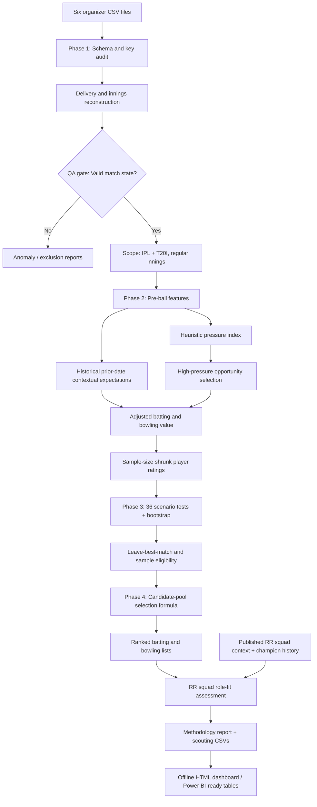
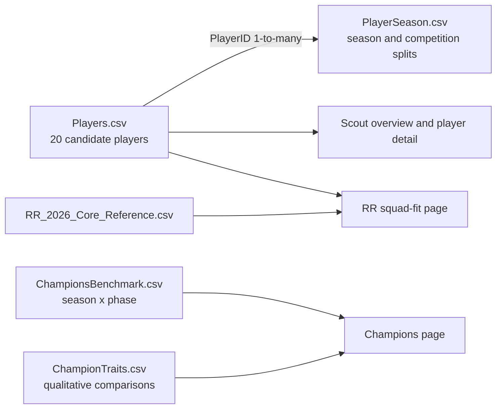

# SupeRR Selector Season 2 — Complete Project README

**Project:** Pressure-reliable T20 player identification and Rajasthan Royals (RR) IPL 2027 squad-fit analysis  
**Status:** Working, documented **candidate** model and Power BI-ready dashboard; not independently validated as an optimal predictive selection model  
**Analysis cutoff:** Project files assembled November 2026  
**Data sources:** Six organizer CSVs (IPL and T20I records from 2022 onwards), plus published squad/champion references used only for descriptive RR planning  
**Deliverables:** Ordered batting and bowling shortlists, methodological PDF, CSVs and HTML/Power BI-ready dashboard  
**Important scope filter:** Pakistani players have been omitted from the *recommended player lists at the user's request*. This is **not** specified as an eligibility rule in the supplied original Round 1 statement. Historical model data still includes IPL and T20I records.

## Table of contents

1. [Problem statement, objectives and outputs](#1-problem-statement-objectives-and-outputs)
2. [Project architecture and data flow](#2-project-architecture-and-data-flow)
3. [Input datasets and joining logic](#3-input-datasets-and-joining-logic)
4. [Phase-by-phase implementation](#4-phase-by-phase-implementation)
5. [Complete equation register](#5-complete-equation-register)
6. [Assumptions and exclusions](#6-assumptions-and-exclusions)
7. [Validation and sensitivity results](#7-validation-and-sensitivity-results)
8. [Final candidate player rankings](#8-final-candidate-player-rankings)
9. [Rajasthan Royals 2027 fit and champion comparison](#9-rajasthan-royals-2027-fit-and-champion-comparison)
10. [Dashboard architecture and instructions](#10-dashboard-architecture-and-instructions)
11. [Reproducibility and file inventory](#11-reproducibility-and-file-inventory)
12. [Known limitations and next-version recommendations](#12-known-limitations-and-next-version-recommendations)
13. [Abbreviation glossary](#13-abbreviation-glossary)

---

## 1. Problem statement, objectives and outputs

The supplied Round 1 problem asks for a **data-driven system that measures how batters and bowlers perform in high-pressure match situations relative to their usual performance** and produces two ordered top-10 rankings. It explicitly allows participants to devise the definition of pressure. The user subsequently shared a submission request to explain **how shortlisted players might strengthen Rajasthan Royals for the 2027 IPL auction** and compare the recommended team's characteristics with historical IPL champions.

### What this project answers

- Which IPL/T20I players generated positive **context-adjusted batter-run-equivalent impact** in situations classified as high pressure?
- Which candidates are more consistent across pressure matches and model assumptions?
- How could each shortlisted player fill a tactical RR squad role, **assuming auction availability**?
- Which general squad traits resemble the profiles of recent IPL championship teams?

### What the project does **not** establish

- That a given score equals match-winning pressure, a calibrated win probability, or causal clutch ability.
- That a shortlisted player actually improves compared with **their own** normal-pressure baseline: this comparison was proposed for Version 2 but not implemented in the final candidate score.
- That any recommended player will enter the 2027 auction, be affordable, or be retained/released.
- That observed champion traits uniquely cause an IPL title; a non-champion control comparison has not been carried out.

## 2. Project architecture and data flow



### Logical layers

| Layer | Inputs | Transformation | Outputs |
|---|---|---|---|
| Raw | Six CSVs | Source parsing and schema validation | Consistent IDs and event records |
| Quality | Deliveries + match metadata | Extras, legal-ball, wicket and match-state QA | `phase1_outputs/*` |
| Feature | QA records | Pre-delivery phase, wicket resources and recent-wicket signals | `pressure_features_refined.csv` |
| Baseline | Prior-date delivery histories | Smoothed runs and wicket-event expectations | Per-ball expected values |
| Scoring | Actual outcomes + expectations | Run equivalents and shrinkage | Batter/bowler player rating tables |
| Reliability | Per-player/per-match contributions | Scenarios, best-match removal and bootstrap | Phase 3 sensitivity datasets |
| Selection | Audited candidate pool | Minimum exposures and weighted selection score | User-filtered top 10 lists |
| Decision support | Rankings + external RR references | Qualitative role-fit and champion archetypes | PDF, CSVs, HTML/Power BI kit |

**Leakage control:** Each ball's pressure index uses prior state only; expected-outcome baselines use matches on earlier **dates**, not the same or later date. In contrast, retrospective championship and RR fit descriptions are downstream narrative comparisons, not model training features.

## 3. Input datasets and joining logic

| File | Rows | Purpose | Important fields |
|---|---:|---|---|
| `ball_by_ball.csv` | 200,999 | Delivery outcomes, striker, bowler, extras type, wicket and innings data | `match_id`, `innings`, `innings_ball_num`, `striker_id`, `bowler_id`, `runs`, `extras_type`, `dismissal_type` |
| `matches.csv` | 883 | Dates, participating teams, venue, match result and limited revised-target metadata | `match_id`, `comp_id`, `match_date`, `venue_id`, `revised_target` |
| `competitions.csv` | 141 | Season, match format and competition identity | `comp_id`, `comp_name`, `match_format`, `season` |
| `playing_eleven.csv` | 28,381 | Match/player participation and roles | `match_id`, `team_id`, `player_id`, `batting_order` |
| `competition_team_player_mapping.csv` | 6,413 | Player identities within competition/team context | `comp_id`, `team_id`, player ID/name fields |
| `teams.csv` | 353 | Team IDs/names in competitions | `comp_id`, `team_id`, `team_name` |

### Safe relationships

```text
ball_by_ball.match_id     -> matches.match_id
matches.comp_id           -> competitions.comp_id
(matches.comp_id, home/away team ID) -> teams.(comp_id, team_id)
(competition, team, player ID)       -> competition_team_player_mapping
(match_id, team_id, player_id)       -> playing_eleven [deduplicate FIRST]
```

Use **composite keys** where team/player identity is competition-scoped. Avoid joining the complete playing-XI or competition-player mapping directly to balls without checking one-to-many cardinality. Phase 1 found 40 repeated match/team/player playing-XI entries and a small number of observed delivery-player participation mismatches.

### Data scope and exclusions

- Of 883 match metadata rows, 867 match IDs have delivery data; the 16 without deliveries were abandoned fixtures.
- 837 delivery-covered matches are IPL (367) or T20I (470); 30 additional non-IPL domestic T20 matches were excluded from the main rating scope.
- Regular-innings source scope: **193,988** delivery rows. Super Overs (innings 3/4) were excluded.
- Refined model: **193,287** valid pre-delivery observations after 701 rows were excluded for invalid/unusable pressure-state flags. This is an observation count, **not** a count of individually scored batter/bowler opportunities (different exposure denominators apply).
- Source periods extend from 2022 into 2026. IPL/T20I histories are both used even when a proposed RR role is IPL-specific.

## 4. Phase-by-phase implementation

### Phase 1 — Data profiling, interpretation and QA

1. Loaded six CSVs and checked row counts, nulls, duplicate full rows, primary keys, foreign-key coverage, and match coverage.
2. Validated competition/team/player joins; retained ball-level records as the source of actual participation.
3. Determined `extras1_runs` represents an **extras category code**, not an extras run amount. `extras_2_runs` does not comprehensively supply the actual extras amounts. Consequently, `runs` is interpreted as **batter runs**, not team runs.
4. Constructed **provisional** legal-ball logic: `is_legal = extras_type NOT IN ('wide', 'Overstep', 'other')`. This is an empirical dataset-specific mapping, **not a general cricket law**.
5. Separated wicket loss by batting team from **bowler-credited** wickets; e.g., run-outs count as team dismissals but are not credited to a bowler.
6. Flagged four unusual overs in three matches (41509, 14130, 14164), 12 inconsistent wicket records, and other state-quality issues rather than modifying source values without evidence.
7. Computed descriptive phase and venue summaries from **batter runs only**, not official scorecard totals or true bowling economy.
8. Created `delivery_state_qa_v2.csv`, innings/overs anomaly audits, phase and bowling-style summaries, venue proxies, and player-exposure reports.

**Critical scoring constraint:** Exact score-before-ball is generally unavailable once incomplete extras occur. A lower-bound score may be computed as batter runs plus minimum wide/no-ball events, but it is **not an exact innings score**. Therefore target-based required run rate, scored-target win probability, exact innings totals, and conventional runs-conceded economy were deliberately excluded from the main model.

### Phase 2A — Reduced-feature prototype

- Used pre-ball phase, wickets already lost and wickets in preceding 12 recorded deliveries.
- Built a first heuristic pressure index, selected threshold 0.55, and compared player batter-run residuals with prior-date contextual expectations.
- Identified a late-innings bias and a denominator mismatch in the prototype, so **prototype player rankings were not accepted as final**.

### Phase 2B — Refined rating

- Redesigned pressure index to capture some early collapses.
- Matched expected runs to the correct batting/bowling opportunity definitions.
- Added striker-dismissal cost and bowler-credited wicket benefit.
- Applied zero-centered sample-size shrinkage.
- Compared threshold variants and conducted 200 match-cluster bootstrap repetitions.

### Phase 3 — Stress tests

- Tested four pressure formulas × three cutoffs × three wicket prices = **36 primary scenarios** for batters and bowlers.
- Tested pressure-match eligibility thresholds of 5, 10, 15 and 20 matches; studied season/competition splits.
- Added one conservative bowling sensitivity scenario penalizing a recorded wide/no-ball by **at least one run**; this is a scenario, **not** the main bowler scoring formula.
- Measured exposure to each player's single highest-value pressure match by removing it and recalculating the shrunk rating (historical expectations were **not** retrained).

### Phase 4 — Selection and RR-specific presentation

- Required a **minimum 20 pressure matches** and **200 pressure opportunities** to enter the proposed conservative final shortlist.
- Combined baseline score, score without best match and consistency across scenarios via the heuristic selection formula in §5.
- **Caveat:** final Phase 4 scores were computed over a **restricted Phase 3 top-20 best-match audit pool**, not a fresh full-universe candidate evaluation. The final ten per role should be regarded as **recommended candidates**, not globally verified optimal top tens.
- Applied user-requested exclusion of Pakistani players at the selection stage. This is distinct from limiting historical training observations to IPL only.
- Added role-by-role RR 2027 auction-fit descriptions and qualitative similarities with recent IPL champion teams.
- Packaged a 7-page PDF methodology report, an offline interactive HTML dashboard, and Power BI-ready CSV/DAX material. No native `.pbix` file or published Power BI URL was generated.

## 5. Complete equation register

### Notation

- `i`: observed delivery / evaluated opportunity; `p`: player; `c`: historical context cell.
- `w_i`: wickets lost **before** ball `i`.
- `r12_i`: wickets fallen in the preceding 12 **recorded** deliveries.
- `B_i`: phase-dependent base pressure.
- `R_i`: batter runs on an eligible opportunity; `D_i`: striker dismissal indicator; `K_i`: bowler-credited wicket indicator.
- `E[R_i]`, `E[D_i]`, `E[K_i]`: historical, pre-date smoothed expected outcomes for matching opportunities.
- `N_p`: player high-pressure eligible opportunities; `V_i`: adjusted run-equivalent value; `C_p`: scenario top-10 frequency; `L_p`: rating excluding best match.

### E1. Original pressure prototype (replaced)

```text
B1 = 0.08 (powerplay) | 0.28 (middle) | 0.50 (death)
W1 = min(w_i / 8, 1)
T1 = min(r12_i / 2, 1)
P1_i = min(1, B1 + 0.36 * W1 + 0.14 * T1)
```

Its strong death-over weighting masked early collapses. **Not** the final pressure index.

### E2. Refined pre-ball pressure index (implemented)

```text
B = 0.12 (powerplay: overs 1-6)
  | 0.22 (middle: overs 7-15)
  | 0.36 (death: overs 16-20)
W = min(w_i / 7, 1)
T = min(r12_i / 2, 1)
P_i = min(1, B + 0.42 * W + 0.28 * T)
H_i = 1[P_i >= 0.55]
```

All components are nonnegative; the index is capped at one. This **is not a probability**, and the threshold is heuristic. Recent-wicket windows count recorded events rather than exactly 12 legal balls.

### E3. Historical contextual expectations (implemented; hierarchical smoothing)

Broad competition-phase prior for batter runs:

```text
mu_run = (historical_run_sum + 200 * 1.2) / (historical_opportunities + 200)
```

For wicket-event rate:

```text
mu_wkt = (historical_wicket_count + 200 * 0.045) / (historical_opportunities + 200)
```

More granular cell-level expectations:

```text
E[run | c] = (historical_cell_run_sum + 120 * mu_run) /
             (historical_cell_opportunities + 120)
E[wicket | c] = (historical_cell_wickets + 120 * mu_wkt) /
                (historical_cell_opportunities + 120)
```

Comparison dimensions: competition (IPL/T20I), innings, phase, wickets-lost category. Only **prior-date** history contributes to each scored observation. Phase 2 prototype included pace/spin distinctions; the final refined context did **not** include a named bowler, a venue-effect term or match-day bowler form. The broad prior constants and pseudo-sample sizes were **manually set**, not statistically fitted.

**Denominator difference:** for batting, wides are excluded from scored opportunities; for bowling, all provisionally non-legal deliveries (wides, oversteps, `other`) are excluded from scored legal opportunities. Separate outcomes/expectations must use matched denominators.

### E4. Per-ball batter value (implemented)

```text
V_bat_i = (R_i - E[R_i]) - q * (D_i - E[D_i])
q = 7 batter-run equivalents per dismissal
```

Only the striker's own dismissal is charged to that batter. Positive values indicate scoring/dismissal outcomes better than the contextual population expectation.

### E5. Per-ball bowler value (implemented)

```text
V_bowl_i = (E[R_i] - R_i) + q * (K_i - E[K_i])
q = 7 batter-run equivalents per credited wicket
```

Bowler credit includes caught, bowled, LBW, stumped and hit wicket; run-outs are not bowler wickets. This measures **batter runs suppressed**, not full team runs conceded. Core value omits wides/no-balls and other extras.

### E6. Player rating with shrinkage (implemented)

```text
Rating_p = 6 * SUM(V_i for high-pressure eligible opportunities of p) /
           (N_p + 90)
```

The 90-opportunity denominator augmentation shrinks sparse player results towards zero. Units: **estimated adjusted batter-run equivalents per six eligible opportunities**. The zero prior and `90` were engineering choices.

### E7. Leave-best-match test (implemented)

```text
L_p = 6 * (SUM(V_i) - highest_match_total_value_p) /
      (N_p - opportunities_in_that_match + 90)
BestMatchDrop_p = Rating_p - L_p
```

The value subtraction and denominator are recalculated, but expected-outcome histories are **not refit**. The result diagnoses single-match dependence, not player future consistency.

### E8. Scenario frequency (implemented)

```text
ScenarioShare_p = (# scenarios ranking player p in top 10) /
                  (# tested scenarios)
```

Batters use 36 main scenarios; the final bowler consistency field uses **37** including the extras sensitivity scenario. Scenario frequency is a robustness measure across related formulas—not a probability of genuinely being top ten.

### E9. Phase 4 shortlist selection (implemented, heuristic)

```text
SelectionScore_p = 0.55 * Rating_p + 0.35 * L_p + 0.30 * ScenarioShare_p
```

This was used to order the restricted eligible audited candidates. **Caution:** `Rating` and `L` have run-equivalent units whereas `ScenarioShare` lies in `[0, 1]`; weights have not been calibrated onto a common scale. This is reproducible but **not a statistically validated optimal formula**. Coefficients add to 1.20, which is not in itself an algebraic error.

### E10. Match-level bootstrap top-10 frequency (implemented; exploratory)

```text
BootstrapTop10Share_p = (number of bootstrap replications with p in top 10) / 200
```

200 resamples of entire matches with replacement. Approximate 5th–95th percentiles of resampled ratings were reported; these were **not** independently calibrated confidence limits.

### E11. One-run extras sensitivity (tested, not core model)

```text
MinimumExtrasDebit = number of high-pressure recorded wide/no-ball events
BowlValueSensitivity = CoreBowlValue - MinimumExtrasDebit
```

This assumes **at least one run** per recorded wide/no-ball in the tested scenario. It is not an official extras calculation and leaves other missing extras unresolved.

### E12. Descriptive dashboard rates (implemented as reporting metrics)

```text
BattingRunRatePer6 = 6 * recorded_batter_runs / non_wide_batting_opportunities
BatterStrikeRateProxy = 100 * recorded_batter_runs / non_wide_batting_opportunities
BowlingBatterRunsConcededPer6 = 6 * recorded_batter_runs_conceded / legal_bowling_deliveries
CreditedWicketRatePer100 = 100 * bowler_credited_wickets / legal_bowling_deliveries
```

**Do not label** `BowlingBatterRunsConcededPer6` as official bowling economy. The numerator omits incompletely recorded extras; batter rates and player dashboards are **dataset-derived proxies**, not guaranteed official scorecard values.

### E13. Calculations proposed for Version 2 (NOT implemented)

```text
PressureUplift_p = mean_context_adjusted_value_under_pressure_p
                   - mean_context_adjusted_value_in_ordinary_states_p
ConservativeScore_p = estimated_pressure_ability_p
                      - lambda * bootstrap_standard_error_p
SmoothPressureWeight(P) = 1 / (1 + exp(-k * (P - midpoint)))
```

Also proposed but **not implemented**: context-specific wicket cost from expected remaining batter runs, learned opponent-quality/venue adjustments, exact target-based run-rate pressure, and chronological holdout selection validation. Do **not** describe E13 as part of the submitted ranking computation.

## 6. Assumptions and exclusions

| Assumption / choice | Reason | Impact / caveat |
|---|---|---|
| Phase boundaries are 1–6, 7–15, 16–20 | Standard operational T20 phases | Approximates scoring roles; unusual innings require care |
| Wickets-before and recent wickets proxy pressure | Observable without exact team scores | Misses high-run-rate chases and scoreboard pressure |
| Phase bases .12/.22/.36 and weights .42/.28 | Interpretable heuristic | Weight choice affects top-10 membership |
| 0.55 cutoff | Clear high-pressure subset | Sharp threshold creates discontinuities |
| Recent window = 12 recorded deliveries | Available sequence identifiers | Not identical to 12 legal balls |
| `runs` = batter runs | Phase 1 field audit | Can't infer exact team totals |
| Wide, Overstep, other = provisional nonlegal | Over-length reconciliation | Has flagged exceptional over records |
| Seven-run-equivalent wicket | Simple joint batter/bowler value metric | Not calibrated to game state |
| 200, 120 historical pseudo-opportunities | Sparse context smoothing | Arbitrary prior strengths |
| 1.2 run, .045 wicket default priors | Baseline fallback | Not fitted/optimized |
| 90 opportunity shrinkage | Penalize low exposure | Can over/under-shrink different roles |
| ≥50 prior comp-phase opportunities | Avoid empty early-history estimates | Excludes initial warmup rows |
| ≥20 pressure matches and ≥200 pressure opportunities | More reliable candidate pool | Excludes potentially strong low-sample players |
| IPL and T20I pooled with competition reference strata | Larger comparison sample | Different competition standards still matter |
| No exact extras or chase required rate | Source fields insufficient | Important omission for scoring pressure and bowling accuracy |
| No actual pitch, dew, wind, boundaries | Not in supplied files | Venue-only proxy can't establish pitch behavior |
| Super Overs excluded | Distinct rules and situation | Removes extreme pressure sample |
| No named-opponent strength in refined baseline | Simpler, verified model | Certain opponents/roles may be harder than others |
| Player shortlist excludes Pakistani players | User selection requirement | Not an organizer-stated eligibility rule |
| RR squad based on 2026 references | Available published context | **Not** proof of 2027 retentions/release |
| All proposed auction signings are hypothetical | 2027 auction availability unknown | Must check official lists before making concrete bids |

## 7. Validation and sensitivity results

| Test | Documented finding | Interpretation |
|---|---|---|
| Refined high pressure | **60,233 / 193,287** valid observations (31.16%) | Proxy predominantly recognizes later-innings events |
| Phase distribution of high pressure | Powerplay **1,785**; middle **21,737**; death **36,711** | Early collapse coverage improved, still uneven |
| Four pressure definitions × three cutoffs × three wicket prices | **36** primary model variants | Stress-tests subjective method choices |
| Median top-10 membership overlap | Batting **7/10**; bowling **8/10** | Ranking membership is sensitive; exact ordering less secure |
| 200-replicate match bootstrap | Top-10 selection shares and 5th–95th percentiles | Approximate uncertainty, not fully calibrated |
| Best-match removal | Sufiyan Muqeem 2.99→2.03; Narine 2.45→2.26; Rashid Khan 2.04→1.90 | Different single-match concentration risks |
| 20 pressure-match restriction | Changed top-ten membership versus looser policy | Exposures affect candidate selection |
| One-run extras debit scenario | Did not change baseline bowling top-10 membership | Does **not** validate missing true extras as harmless |
| Season and IPL/T20I splits | Exported descriptive player slices | Some player-season and competition cells sparse |
| Chronological 2026 holdout validation | **Not performed** | Cannot claim proven future predictive ability |

**Key interpretive rule:** A high score indicates positive model-adjusted performance under the defined pressure proxy. It does **not** establish ability under exact scoreboard pressure nor a player-specific increase over ordinary performance.

## 8. Final candidate player rankings

Rankings below reproduce the **user-filtered Phase 4 candidate lists** from the shipped CSV files. Rating is shrunk run-equivalent value per six eligible high-pressure opportunities; selection score is the heuristic described in E9. Rank order should not be interpreted as a verified global optimum across every eligible player.

### Batters

| Rank | Player | Player ID | Pressure opportunities | Pressure matches | Shrunk rating | Scenario consistency | Selection score |
|---:|---|---:|---:|---:|---:|---:|---:|
| 1 | Suryakumar Yadav | `1699` | 402 | 51 | 2.444 | 36/36 | 2.397 |
| 2 | Tim David | `6396` | 837 | 85 | 2.046 | 36/36 | 2.081 |
| 3 | Naman Dhir | `37052` | 282 | 30 | 2.000 | 36/36 | 1.969 |
| 4 | Nicholas Pooran | `3125` | 532 | 56 | 2.047 | 11/36 | 1.869 |
| 5 | Ashutosh Sharma | `8101` | 301 | 26 | 1.861 | 30/36 | 1.741 |
| 6 | Shreyas Iyer | `3647` | 362 | 41 | 1.867 | 19/36 | 1.735 |
| 7 | Rinku Singh | `4708` | 793 | 77 | 1.621 | 18/36 | 1.531 |
| 8 | Namboori Tilak Varma | `7897` | 728 | 79 | 1.612 | 18/36 | 1.481 |
| 9 | Shashank Singh | `2756` | 391 | 37 | 1.451 | 29/36 | 1.419 |
| 10 | Romario Shepherd | `6726` | 606 | 65 | 1.455 | 18/36 | 1.361 |

### Bowlers

| Rank | Player | Player ID | Pressure opportunities | Pressure matches | Shrunk rating | Scenario consistency | Selection score |
|---:|---|---:|---:|---:|---:|---:|---:|
| 1 | Sunil Narine | `781` | 420 | 47 | 2.446 | 37/37 | 2.438 |
| 2 | Kuldeep Yadav | `3644` | 606 | 64 | 2.064 | 36/37 | 2.080 |
| 3 | Rashid Khan | `4722` | 998 | 102 | 2.041 | 34/37 | 2.064 |
| 4 | Jasprit Bumrah | `2933` | 628 | 67 | 1.874 | 26/37 | 1.798 |
| 5 | Varun Chakravarthy | `6256` | 702 | 70 | 1.813 | 23/37 | 1.759 |
| 6 | Rahul Chahar | `6161` | 215 | 24 | 1.814 | 10/37 | 1.573 |
| 7 | Tim Southee | `278` | 250 | 29 | 1.732 | 10/37 | 1.531 |
| 8 | Matheesha Pathirana | `8661` | 613 | 49 | 1.652 | 11/37 | 1.502 |
| 9 | Yuzvendra Chahal | `1612` | 665 | 73 | 1.716 | 0/37 | 1.453 |
| 10 | Noor Ahmad | `7967` | 502 | 52 | 1.611 | 7/37 | 1.388 |

### Ranking interpretation

- Higher **rating** means more context-adjusted high-pressure value per six eligible opportunities after shrinkage.
- Higher **scenario consistency** means a player appears frequently in the top ten under the tested alternative formulas; scenarios are correlated.
- Higher **selection score** means a stronger value under the specific weighted Phase 4 shortlist policy.
- These counts and outputs are **not** official IPL runs/strike rates/economies; they are computed on the supplied IPL/T20I combined sample.

## 9. Rajasthan Royals 2027 fit and champion comparison

The following are **scouting hypotheses**, not changes to the mathematical pressure ratings. They draw on the `Players.csv` role-fit fields and RR 2026 reference squad information. Actual 2027 personnel, retention, release, purse, auction registration, prices and overseas slots must be confirmed separately.

### Every shortlisted batter: possible RR contribution

| Rank | Player (ID) | Potential RR role | How they could help | Key tradeoff |
|---:|---|---|---|---|
| 1 | Suryakumar Yadav (`1699`) | Middle-order accelerator | Game-breaking spin and pace scoring through middle overs | Luxury upgrade; competes with Parag and Jurel for middle-order allocation |
| 2 | Tim David (`6396`) | Overseas finisher | Six-hitting to lift late-over run production | Potential power upgrade but overlaps Hetmyer/overseas finishers |
| 3 | Naman Dhir (`37052`) | Indian finisher | Domestic late-over hitting and multi-phase adaptability | Indian batting depth without using overseas quota |
| 4 | Nicholas Pooran (`3125`) | Overseas left-handed keeper-batter | High-tempo middle-order batting and secondary keeper option | Strong upside but duplicates wicketkeeping and overseas batting roles |
| 5 | Ashutosh Sharma (`8101`) | Indian finisher | Acceleration from lower middle-order under pressure | Adds Indian late-innings hitting alongside Jurel/Parag |
| 6 | Shreyas Iyer (`3647`) | Indian middle-order batter | Control against spin and stabilizing innings | Provides consolidation but overlaps RR middle-order core |
| 7 | Rinku Singh (`4708`) | Indian left-handed finisher | Repeatable late-over hitting and chase resilience | Ideal Indian finishing option; keeps overseas slots free |
| 8 | Tilak Varma (`7897`) | Indian left-handed batter | Flexible middle-order acceleration and batting balance | Long-term No.3–5 option if role opens up |
| 9 | Shashank Singh (`2756`) | Indian finisher | Lower-order boundary scoring and pressure response | Adds Indian finishing and impact-sub flexibility |
| 10 | Romario Shepherd (`6726`) | Overseas seam all-rounder | Late-order batting power, potentially extra seam utility | Adds batting depth; bowling utility not proven by this batting score |

### Every shortlisted bowler: possible RR contribution

| Rank | Player (ID) | Potential RR role | How they could help | Key tradeoff |
|---:|---|---|---|---|
| 1 | Sunil Narine (`781`) | Overseas mystery-spin all-rounder | Powerplay/middle-over wicket and run control plus batting flexibility | Different spin weapon but overlaps Jadeja/Bishnoi positions |
| 2 | Kuldeep Yadav (`3644`) | Indian left-arm wrist spinner | Middle-overs wicket-taking and left-arm wrist-spin variation | Attacking spin alternative; must justify overlap with Bishnoi/Jadeja |
| 3 | Rashid Khan (`4722`) | Overseas leg spinner | High-leverage spin and middle-over control | Elite spin variation but overseas and role overlap constraints |
| 4 | Jasprit Bumrah (`2933`) | Indian powerplay/death fast bowler | Precision at both ends of innings, wicket-taking | Potentially highest marginal benefit alongside Archer |
| 5 | Varun Chakravarthy (`6256`) | Indian mystery spinner | Wicket-taking in middle overs against settled batters | Alternative attacking style alongside RR spin core |
| 6 | Rahul Chahar (`6161`) | Indian leg spinner | Leg-spin wicket threat and domestic depth | Spin rotation, but direct overlap with Bishnoi |
| 7 | Tim Southee (`278`) | Overseas swing bowler | New-ball movement and experienced powerplay plans | Powerplay/pace cover if overseas slot is available |
| 8 | Matheesha Pathirana (`8661`) | Overseas death-over fast bowler | Unusual-angle pace and specialist late-over wickets | High-value end-overs differentiator with Archer |
| 9 | Yuzvendra Chahal (`1612`) | Indian leg spinner | Middle-overs wickets and attacking leg spin | Domestic spin rotation but overlaps Bishnoi |
| 10 | Noor Ahmad (`7967`) | Overseas left-arm wrist spinner | Opposite-angle spin and middle-overs matchups | Alternative wrist spin, subject to overseas capacity |

### Champion benchmark approach

`ChampionsBenchmark.csv` contains 15 season-phase observations (five champion seasons × three innings phases). Compared winners: **2022 Gujarat Titans**, **2023 Chennai Super Kings**, **2024 Kolkata Knight Riders**, **2025 Royal Challengers Bengaluru**, and **2026 Royal Challengers Bengaluru**. For each champion's **season games** (not just its final), the file records batter-only runs per six scored opportunities, batter-only runs conceded per six legal balls, and bowler-credited wickets per 100 legal balls.

| Observed squad-building theme | RR candidate examples | RR-specific decision constraint |
|---|---|---|
| Flexible middle-order acceleration | Suryakumar Yadav, Shreyas Iyer, Tilak Varma | Existing Parag/Jurel roles may overlap |
| Closing and lower-order six-hitting | Tim David, Rinku Singh, Shashank Singh, Ashutosh Sharma | Batting order, overseas quota and role duplication |
| Wicket-taking spin in middle overs | Kuldeep Yadav, Varun Chakravarthy, Rashid Khan, Noor Ahmad | Complement existing Bishnoi/Jadeja skill sets |
| Powerplay/death pace options | Jasprit Bumrah, Matheesha Pathirana, Tim Southee | Quality, availability, overseas slots and cost |
| Multi-dimensional squad balance | Sunil Narine, Rashid Khan, batting-depth candidates | Role flexibility should not duplicate existing specialist value |

**Interpretation:** These are traits and tactical analogies, **not findings that all champions share one statistically distinct formula**. No control group of runners-up or non-champions was analyzed, and no claim of causal championship advantage is justified.

### Difference between sporting fit and auction feasibility

1. **Performance evidence:** Data-based, limited to available matches and the model's pressure proxy.
2. **Squad-role fit:** Analyst interpretation of tactical complementarity, not measured gain in wins.
3. **Auction feasibility:** **Unverified** for 2027; no player is claimed available or purchasable.
4. **Roster rule:** IPL playing XI overseas-player capacity and auction/retention rules must be checked for the relevant 2027 regulations before operational decisions.

## 10. Dashboard architecture and instructions

### Data model



- `Players.csv`: `PlayerID`, name, role, pressure ratings, observed opportunity statistics, reliability fields, RR contribution, fit and availability caveats. The unique intended key is `Category + PlayerID`; validate `PlayerID` uniqueness before using a single-column relation.
- `PlayerSeason.csv`: player-season/competition observations; relate `Players[PlayerID]` (one) to `PlayerSeason[PlayerID]` (many) **only if IDs are verified unique in Players**.
- `ChampionsBenchmark.csv`: 2022–2026 champions' phase-wise **batter-run proxies** and wicket statistics; independent comparison table.
- `ChampionTraits.csv`: narrative RR/champion archetypes; intentionally disconnected.
- `RR_2026_Core_Reference.csv`: selective RR incumbent roles, **not a confirmed 2027 roster**.

### Four intended report views

1. **Scouting overview:** Candidate counts, batting/bowling comparison, ratings, pressure opportunities and match counts.
2. **Player detail:** Search/slicer by name or player ID, stats, season splits, best-match sensitivity, RR role, auction caveat.
3. **Champions benchmark:** Five title years × powerplay/middle/death scoring and credited-wicket measures; clearly display units.
4. **RR squad strategy:** Existing RR reference roles vs prospective targets, tactical complementarity and tradeoffs.

### What is delivered vs not delivered

- **Delivered:** `RR_2027_Interactive_Dashboard.html`, five dashboard CSV tables, `PowerBI_DAX_Measures.txt`, Power BI build guide, and ZIP kit.
- **Not delivered:** native editable `.pbix` project or published Power BI Service URL. Those require authoring the file in Power BI Desktop and publishing from an account with appropriate access.

### Steps to create a native Power BI report

1. Extract the dashboard ZIP to a stable folder.
2. Power BI Desktop → Get Data → Text/CSV: import the five tables.
3. Set `PlayerID` to whole number; metrics to decimal; Season to text where values span years; category/role to text.
4. Model view: create the verified 1-to-many Players-to-PlayerSeason relationship; leave three comparison tables disconnected.
5. Add each DAX measure in `PowerBI_DAX_Measures.txt`, then build four visual pages above.
6. Validate field meanings and tooltips—**batter runs per six** must not appear as official bowling economy.
7. Save `.pbix`; optionally publish in Power BI Service for a shareable URL.

## 11. Reproducibility and file inventory

### Input files (place at project root)

```text
ball_by_ball.csv
matches.csv
competitions.csv
teams.csv
playing_eleven.csv
competition_team_player_mapping.csv
```

### Analysis source files and derived artifacts

```text
SupeRR project root/
├── six source CSVs
├── phase1_analysis_package.zip
│   ├── phase1_step14_scoring_qa.py
│   └── phase1_step15_17_eda.py
├── phase1_outputs/
│   ├── PHASE1_FINDINGS.md
│   ├── delivery_state_qa_v2.csv
│   ├── innings_scoring_qa_v2.csv
│   ├── overs_scoring_qa_v2.csv
│   ├── wicket_record_anomalies.csv
│   └── [phase, venue, player sample QA CSVs]
├── phase2_reduced_pressure_package.zip
│   ├── phase2_reduced_pressure_model.py
│   └── phase2_validate_and_package.py
├── phase2_refined_package.zip
│   └── phase2_refine.py
├── phase2_refined/
│   ├── pressure_features_refined.csv
│   └── METHODOLOGY_AND_VALIDATION.md
├── phase3_sensitivity_package.zip
│   └── phase3/run_phase3.py
├── phase3/
│   ├── PHASE3_FINDINGS.md
│   └── [sensitivity, competition/season, best-match CSVs]
├── phase4/
│   ├── README.md
│   └── no_pakistan/
│       ├── bat_updated_top10.csv
│       ├── bowl_updated_top10.csv
│       └── SupeRR_Methodology_and_Rankings_No_Pakistan.docx
├── final_rr/
│   └── SupeRR_Selector_RR_IPL_2027_Methodology_and_Auction_Fit.pdf
├── rr_powerbi_dashboard/
│   ├── Players.csv
│   ├── PlayerSeason.csv
│   ├── ChampionsBenchmark.csv
│   ├── ChampionTraits.csv
│   ├── RR_2026_Core_Reference.csv
│   ├── RR_2027_Interactive_Dashboard.html
│   ├── PowerBI_DAX_Measures.txt
│   ├── PowerBI_Build_Guide.md
│   └── README.md
└── SupeRR_Selector_Complete_Project_README.md  [THIS FILE]
```

### Execution sequence

The packaged scripts are **independently preserved but not consolidated into a single pip-installable repository**. Their original scripts use `/mnt/data`-style paths and assume outputs from earlier phases. Reproduction requires extracting each package and adapting path constants for a different computer.

```bash
# From a Python environment with pandas and numpy (and any extra
# imports required by the individual scripts), after path configuration:
python phase1_step14_scoring_qa.py
python phase1_step15_17_eda.py
python phase2_reduced_pressure_model.py
python phase2_validate_and_package.py
python phase2_refine.py
python phase3/run_phase3.py
```

Phase 4 candidate selection, RR scouting narrative and dashboard generation were saved as outputs/documentation; **a single clean end-to-end Phase 4 rebuild command is not supplied**. The Phase 4 rankings should be reproducibility-audited before asserting they can be rebuilt from scratch by an independent reviewer.

### Data and output checks to run after reproduction

```python
import pandas as pd
from pathlib import Path
r = Path('.')
bat = pd.read_csv(r / 'phase4/no_pakistan/bat_updated_top10.csv')
bowl = pd.read_csv(r / 'phase4/no_pakistan/bowl_updated_top10.csv')
players = pd.read_csv(r / 'rr_powerbi_dashboard/Players.csv')
assert len(bat) == len(bowl) == 10
assert bat['striker_id'].nunique() == 10
assert bowl['bowler_id'].nunique() == 10
assert len(players) == 20
assert not players.duplicated(['Category','PlayerID']).any()
print('Basic deliverable checks passed')
```

This **checks file shape and uniqueness**, not model correctness or player eligibility against the full pool.

### Reporting artifacts

- Methodology & RR auction analysis: `final_rr/SupeRR_Selector_RR_IPL_2027_Methodology_and_Auction_Fit.pdf`.
- RR-specific user-filtered rankings: `phase4/no_pakistan/*_updated_top10.csv`.
- Power BI kit: `SupeRR_RR_2027_PowerBI_Dashboard_Kit.zip`.
- Offline interactive dashboard: `rr_powerbi_dashboard/RR_2027_Interactive_Dashboard.html`.

## 12. Known limitations and next-version recommendations

### Critical limitations

1. **Incomplete extras/targets.** Cannot derive accurate official score, required run rate, first-innings par, win probability or all bowling runs conceded.
2. **Heuristic pressure.** The proxy is heavily phase-dependent, and even after refinement only 1,785 high-pressure deliveries occur in powerplay.
3. **Not a player-specific pressure uplift.** Current score measures above-population expectation *when under pressure*, not the difference against the same player's usual performance. Original challenge explicitly asks for comparison with usual performance.
4. **Uncalibrated wicket cost.** Constant 7 runs for all wickets, contexts and phases.
5. **Uncalibrated final selection.** Mixes run-equivalent ratings with a `[0,1]` scenario-frequency share; restricted Phase 3 candidate pool.
6. **Uncertainty remains.** Model scenario overlap is not independent statistical validation; bootstrap samples are exploratory.
7. **No out-of-time ranking verification.** 2026 was not reserved as a pure untouched future holdout.
8. **Opponent/venue data not in final scoring.** Phase/style/venue were analyzed descriptively, but no named-bowler or actual pitch adjustment was fitted in the refined rating.
9. **2027 transaction feasibility unknown.** Tactical RR role fit is hypothetical, and roster/retentions/auction registration may change.
10. **Champion comparison is descriptive.** No non-champion control group or causal inference.

### Highest-value Version 2 improvements (not completed)

| Priority | Action | Test of success |
|---|---|---|
| P0 | Re-score **all eligible** players, not just restricted finalist pool | Top 10 emerges from complete registered candidate universe |
| P0 | Compute player-specific **pressure uplift versus ordinary states** | Directly answers Round 1 wording |
| P0 | Use a consistent uncertainty-aware ranking score (e.g., `estimate − λ × SE`) | Stability improves without unit mixing |
| P0 | Out-of-time train 2022–24, tune 2025, test 2026; then refit all years | Positive held-out pressure value and calibrated uncertainty |
| P1 | Continuous pressure weighting in addition to cutoff analysis | Less sensitivity to .55 boundary |
| P1 | State-varying wicket cost based on expected remaining batter runs | Better early vs late wicket valuation |
| P1 | Historical-only bowler quality, role, venue shrinkage | Out-of-time errors improve over simpler baseline |
| P1 | Reconstruct extras from scorecards if later made available | True run-rate and more complete bowler performance |
| P1 | Compare champion teams **against non-champions** with similar competition/season exposure | Quantified trait differences instead of anecdotes |
| P1 | Check official 2027 roster/auction registrations and feasibility | Actionable RR bids with price/slot constraints |

## 13. Abbreviation glossary

| Abbreviation | Expansion / interpretation |
|---|---|
| RR | Rajasthan Royals |
| IPL | Indian Premier League |
| T20 | Twenty20 cricket format |
| T20I | Twenty20 International |
| XI | Playing eleven |
| PBI / Power BI | Microsoft Power BI business intelligence/reporting software |
| CSV | Comma-separated values |
| DAX | Data Analysis Expressions (Power BI measure language) |
| PDF | Portable Document Format |
| PPT / PPTX | PowerPoint presentation / presentation file |
| QA | Quality assurance / data validation |
| EDA | Exploratory data analysis |
| KPI | Key performance indicator |
| RRR | Required run rate (**not computable reliably here**) |
| SR | Strike rate; here often a dataset-derived non-wide-delivery proxy |
| ER | Economy rate; **not official** when extras amounts are missing |
| PP | Powerplay, overs 1–6 |
| MO | Middle overs, overs 7–15 |
| DO | Death overs, overs 16–20 |
| LBW | Leg before wicket |
| H / HP | High-pressure indicator/classification |
| P | Pressure index, range 0–1 (not probability) |
| E[·] | Statistical expectation based on historical comparator data |
| μ (mu) | Mean/reference rate |
| V | Context-adjusted run-equivalent value on an opportunity |
| N | Number of eligible opportunities |
| R | Batter runs on an opportunity (when used in scoring equations) |
| D | Striker-dismissal indicator |
| K | Bowler-credited wicket indicator |
| S | Weighted Phase 4 selection score |
| SE | Standard error |
| CI | Confidence interval (formal calibration not established here) |
| P0 / P1 | Highest/next priority improvement tier |
| DLS | Duckworth–Lewis–Stern rain-adjustment method; not fully reconstructed in this project |

---

## Provenance and interpretive guardrails

- **Numerical project measurements:** Original organizer CSVs and derived Phase 1–4 records bundled locally.
- **Methodology parameters:** Documented engineering assumptions from Phase 2–4 scripts and notes, not external cricket laws or statistically optimized parameters.
- **RR squad fit:** Qualitative scouting interpretation using the existing 2026 RR reference profile, not confirmed IPL 2027 contracts.
- **Championship benchmark:** Descriptive historical phase aggregates for the 2022–2026 winning franchises, not controlled evidence of title causation.
- **Use in a hackathon submission:** Treat the current rank lists as **supported but provisional recommendations**. Disclose dataset scoring limits, eligibility filtering, candidate-pool restriction, uncertainty and auction availability. Do not claim a completed native PBIX, live dashboard URL, exact win-probability model or fully reproducible single-command pipeline.
